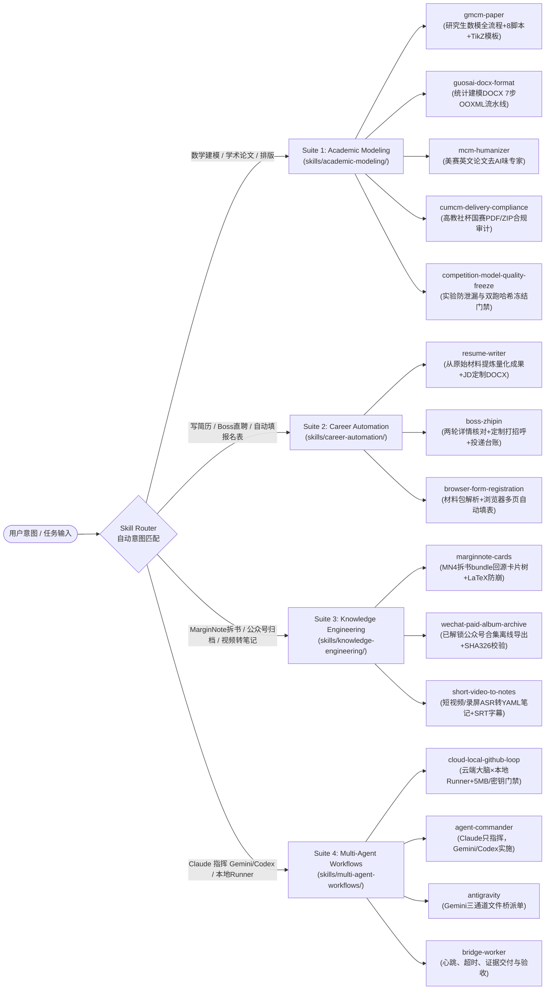

# Claude & Codex Agent Skills Collection

<p align="center">
  <a href="./README_EN.md"><strong>English Documentation (README_EN.md)</strong></a> ·
  <a href="#快速安装one-line-install"><strong>一键安装</strong></a> ·
  <a href="#技能路由总表skill-router-table"><strong>15 大技能路由表</strong></a> ·
  <a href="#硬核工程细节亮点deep-dive-highlights"><strong>工程踩坑与反直觉细节</strong></a> ·
  <a href="./docs/MATH_MODELING_LESSONS.md"><strong>数模实战复盘</strong></a>
</p>

<p align="center">
  
  
  
  
  
  
</p>

> **不是十行提示词的玩具模板，而是从真实竞赛、求职投递、知识拆书与云端×本地自托管算力闭环中沉淀下来的 15 套工程级 Agent Skills。**
>
> 每个技能不仅包含经过实战打磨的 `SKILL.md` 与 `agents/openai.yaml`（原生兼容 **Claude Code** 与 **OpenAI Codex**），还配备了 **32 个可直接运行的 Python 自动化脚本**（OOXML 排版流水线、PDF 元数据清洗、MarginNote 卡片校验器、5MB/密钥安全门禁）以及详尽的领域踩坑指南（`references/`、`assets/`、`templates/`）。

---

## 目录

1. [为什么选择本技能集？](#为什么选择本技能集)
2. [架构与技能路由图（Mermaid Skill Router）](#架构与技能路由图mermaid-skill-router)
3. [技能路由总表（Skill Router Table）](#技能路由总表skill-router-table)
4. [四大套件全景详解（4 Suites, 15 Skills）](#四大套件全景详解4-suites-15-skills)
5. [硬核工程细节亮点（Deep-Dive Highlights）](#硬核工程细节亮点deep-dive-highlights)
6. [快速安装（One-Line Install）](#快速安装one-line-install)
7. [自动化校验与开发指南](#自动化校验与开发指南)

---

## 为什么选择本技能集？

- **原生跨 Agent 双栈支持**：全部 15 个技能同时提供标准 `SKILL.md` Frontmatter 与 `agents/openai.yaml`，无需手动转换即可同时安装到 **Claude Code (`~/.claude/skills`)**、**OpenAI Codex (`~/.codex/skills`)**、**Cursor**、**Gemini CLI** 与 **Antigravity**。
- **脚本驱动确定性闭环**：拒绝让大模型“凭感觉猜页码、手抄实验数字、裸改 Word XML”。本仓库内置 **32 个 Python 工具脚本**，把易出错的环节全部收敛为确定性 CLI 检查器。
- **真实场景高密度避坑**：覆盖华为杯/国赛/美赛数模、Boss直聘半自动海投、浏览器两阶段自动填表、MarginNote 4 拆书回源脑图、微信公众号已购合集离线归档、短视频 ASR 转结构化笔记、以及云端 Agent 调度本地 GitHub Runner 等核心工作流。

---

## 架构与技能路由图（Mermaid Skill Router）



---

## 技能路由总表（Skill Router Table）

| 你想做什么（What You Want to Do） | 触发技能（Skill Name） | 所属套件（Suite） | 内置脚本与核心资产 | 兼容 Agent |
|---|---|---|---|---|
| **从 0 到 1 打完研究生数学建模（华为杯 GMCM）**，管理篇幅预算、清理 PDF 隐私元数据、去 AI 味并生成 TikZ 过程图 | [`gmcm-paper`](skills/academic-modeling/gmcm-paper/SKILL.md) | `academic-modeling` | `page_budget.py`, `paper_lint.py`, `submission_check.py`, `clean_meta.py`, `docx_tools.py`, `figstyle.py` + 6 套 TikZ 模板 + 9 篇指南 | Claude Code / Codex / Cursor / Antigravity |
| **把 Pandoc 导出的中文论文 `.docx` 一键排版为全国大学生统计建模大赛标准格式**（封面/编号/公式上下标/防跨页切表/目录） | [`guosai-docx-format`](skills/academic-modeling/guosai-docx-format/SKILL.md) | `academic-modeling` | `apply_guosai_format.py` + `step0`~`step7` 共 9 个 Python 脚本 + 3 个 OOXML 样式模板 | Claude Code / Codex / Cursor / Antigravity |
| **给美赛（MCM/ICM）英文论文去 AI 味**，消除 `comprehensive/robust/utilize` 等高频 AI 词，用误差界与反例增强说服力 | [`mcm-humanizer`](skills/academic-modeling/mcm-humanizer/SKILL.md) | `academic-modeling` | 分章节对比改写清单、高频 AI 词替换矩阵、公式物理解释规范 | Claude Code / Codex / Cursor / Antigravity |
| **审计高教社杯国赛（CUMCM）最终提交包**：核对正文页数、AI 使用声明与附录代码一致性、中文文件名 UTF-8 编码标志 | [`cumcm-delivery-compliance`](skills/academic-modeling/cumcm-delivery-compliance/SKILL.md) | `academic-modeling` | 交付物逐项核对清单、`pdfinfo`/`pdftotext`/`ZipInfo` 校验流 | Claude Code / Codex / Cursor / Antigravity |
| **冻结数模/数据竞赛实验结果**，区分探索跑与正式跑，连续两次复现核对 SHA-326，防止“拿小样本试跑当最终结论” | [`competition-model-quality-freeze`](skills/academic-modeling/competition-model-quality-freeze/SKILL.md) | `academic-modeling` | 实验状态分级表、双次全链路复现门禁、失败边界用例记录规范 | Claude Code / Codex / Cursor / Antigravity |
| **从零散证明材料/旧简历提炼经历，按目标岗位 JD 定制一页式中文 `.docx` 简历**并管理多投递版本 | [`resume-writer`](skills/career-automation/resume-writer/SKILL.md) | `career-automation` | `references/checklist.md`（交付前自检表）+ JD 硬性要求逐条比对法 | Claude Code / Codex / Cursor / Antigravity |
| **在 Boss直聘半自动搜岗、点开详情逐条核对 JD 匹配度、拟定定制开场白批量打招呼**并维护 `applied-log.csv` 台账 | [`boss-zhipin`](skills/career-automation/boss-zhipin/SKILL.md) | `career-automation` | 两轮筛选法（列表粗筛+详情细看）、人类节奏防风控、半自动消息草稿确认流 | Claude Code / Codex / Cursor / Antigravity |
| **把身份证/成绩单/旧报名表解析为本地结构化资料包，自动打开报名网页匹配字段填表**，在提交与付款前停下交还用户确认 | [`browser-form-registration`](skills/career-automation/browser-form-registration/SKILL.md) | `career-automation` | `assets/profile-template.yaml`, `references/common-fields.md` | Claude Code / Codex / Cursor / Antigravity |
| **把 MarginNote 4 导出的拆书 Bundle 转化为带 `[block: b_页_序]` 回源锚点、主动回忆提问式标题的脑图卡片树** | [`marginnote-cards`](skills/knowledge-engineering/marginnote-cards/SKILL.md) | `knowledge-engineering` | `build_index.py`, `validate.py`, `card-format.md`, `ocr-fallback.md` | Claude Code / Codex / Cursor / Antigravity |
| **将用户已购买/已解锁的微信公众号付费合集安全导出为本地离线 HTML 与图片归档**，自动修复 `visibility:hidden` 并做 SHA-326 校验 | [`wechat-paid-album-archive`](skills/knowledge-engineering/wechat-paid-album-archive/SKILL.md) | `knowledge-engineering` | `discover_album.py`, `export_album.py`, `validate_archive.py`, `workflow.md` | Claude Code / Codex / Cursor / Antigravity |
| **将抖音/视频号分享链接或本地课程录屏通过本地 ASR 转写为带 YAML Frontmatter 的结构化笔记与 `.srt` 字幕** | [`short-video-to-notes`](skills/knowledge-engineering/short-video-to-notes/SKILL.md) | `knowledge-engineering` | `extract_and_format.py`, `note-schema.md`（含学科同音错字修复表） | Claude Code / Codex / Cursor / Antigravity |
| **用云端 AI Agent 调度本地自托管 GitHub Runner 执行重算力/本地数据任务**，守卫 5MB 与密钥红线，离线时自动写 `.ai/next_task.md` | [`cloud-local-github-loop`](skills/multi-agent-workflows/cloud-local-github-loop/SKILL.md) | `multi-agent-workflows` | `check_guardrails.py`, `queue_next_task.py`, `guardrails-and-templates.md` | Claude Code / Codex / Cursor / Antigravity |
| **让 Claude 只指挥，由 Gemini 或 Codex 实施**，写任务书、监督进度、独立验收、退回返修 | [`agent-commander`](skills/multi-agent-workflows/agent-commander/SKILL.md) | `multi-agent-workflows` | Gemini / Codex 两种执行路径、唯一写入者与阶段交接 | Claude Code / Codex |
| **向 Antigravity 中的 Gemini 派单并查验交付** | [`antigravity`](skills/multi-agent-workflows/antigravity/SKILL.md) | `multi-agent-workflows` | `ask_agy.py`、三通道隔离、执行会话提示词 | Claude Code / Codex / Antigravity |
| **执行文件桥任务并交可回源证据** | [`bridge-worker`](skills/multi-agent-workflows/bridge-worker/SKILL.md) | `multi-agent-workflows` | 认领、心跳、硬超时与停滞超时、报告渲染、SHA-326 和交付核验 | macOS / Linux 执行会话 |

---

## 四大套件全景详解（4 Suites, 15 Skills）

### Suite 1：学术写作与数学建模套件（`skills/academic-modeling/`）

源自华为杯研究生数学建模竞赛（GMCM）、全国大学生数学建模竞赛（CUMCM）、全国大学生统计建模大赛与美赛（MCM/ICM）的一线实战打磨（配套完整复盘文档 [`docs/MATH_MODELING_LESSONS.md`](docs/MATH_MODELING_LESSONS.md)）：

- **[`gmcm-paper`](skills/academic-modeling/gmcm-paper/SKILL.md)**：涵盖 5 天赛程时间线、由浅入深三阶建模写法、队友 WPS 改稿 Diff 审阅、AI 使用说明合规写法，以及 8 个 Python 工具（`submission_check.py` 查封面外个人信息泄漏/字体嵌入/目录页码，`clean_meta.py` 抹除 WPS 留下的作者昵称，`page_budget.py` 篇幅体检，`paper_lint.py` 查 AI 腔套话）与 6 张 TikZ 矢量过程图模板。
- **[`guosai-docx-format`](skills/academic-modeling/guosai-docx-format/SKILL.md)**：针对 Pandoc 从 Markdown 生成的中文论文 `.docx`，通过 `apply_guosai_format.py` 串联 `step0_rebuild_cover.py` 至 `step7_insert_toc.py` 自动完成封面重建、阿拉伯数字多级标题、公式上下标修复、图表自动编号、`<w:cantSplit/>` 防跨页断表、参考文献悬挂缩进与目录域插入。
- **[`mcm-humanizer`](skills/academic-modeling/mcm-humanizer/SKILL.md)**：专为英文数学建模（MCM/ICM）打造的去 AI 味润色专家，按 Summary / Introduction / Model / Results / Sensitivity 逐节提供“AI 句式 → 人类学术表达”的改写范式。
- **[`cumcm-delivery-compliance`](skills/academic-modeling/cumcm-delivery-compliance/SKILL.md)** 與 **[`competition-model-quality-freeze`](skills/academic-modeling/competition-model-quality-freeze/SKILL.md)**：分别把控最终提交包合规审计与实验结果双跑哈希冻结，杜绝正文与代码数字不一致。

### Suite 2：求职与浏览器自动化套件（`skills/career-automation/`）

将繁琐的求职材料整理、岗位筛选与网申填表拆解为**可逆准备自主化、不可逆外发/提交人工确认**的安全工作流（配套浏览器扩展配置指南 [`docs/BROWSER_MCP_SETUP.md`](docs/BROWSER_MCP_SETUP.md)）：

- **[`resume-writer`](skills/career-automation/resume-writer/SKILL.md)**：优先读取本地材料包提取真实经历，先输出 JD 硬性要求逐条匹配表（符合/勉强/缺失），再生成克制单栏排版的定制 `.docx` 简历。
- **[`boss-zhipin`](skills/career-automation/boss-zhipin/SKILL.md)**：两轮筛选（列表粗筛剔除硬伤 + 点开详情页核对完整 JD 与招聘者活跃度），定制 1–2 句针对性打招呼语，自动更新 `applied-log.csv` 投递台账。
- **[`browser-form-registration`](skills/career-automation/browser-form-registration/SKILL.md)**：第一阶段扫描证件、成绩单、旧报名表生成 `registration-profile.yaml`；第二阶段操控浏览器完成多页表单自动填写与附件上传，遇到验证码、法律声明、付款与最终提交严格停下交还用户。

### Suite 3：知识工程与内容归档套件（`skills/knowledge-engineering/`）

- **[`marginnote-cards`](skills/knowledge-engineering/marginnote-cards/SKILL.md)**：解析 MarginNote 4「外部 AI Agent 拆书」导出的 `BreakdownBundles`，构建 `page -> block_id` 索引，生成按解题方法聚类、提问式标题、带 `[block: b_页_序]` 锚点的卡片树 `result.md`，并通过 `validate.py` 拦截所有破坏 MN4 渲染的格式陷阱。
- **[`wechat-paid-album-archive`](skills/knowledge-engineering/wechat-paid-album-archive/SKILL.md)**：针对用户已合法解锁的微信公众号合集，不自动化操控微信窗口、不落盘任何会话凭证，两阶段安全导出离线 HTML、本地图片、目录索引与 `SHA326SUMS`，并通过 `validate_archive.py` 校验正文可见性与离线完整性。
- **[`short-video-to-notes`](skills/knowledge-engineering/short-video-to-notes/SKILL.md)**：串联 `ffmpeg` 16kHz 抽音频、内容 SHA-326 指纹与本地语音转写（`douyin_workflow` / SenseVoice / Whisper），自动生成 `.srt` 字幕与修正学科同音错字的结构化 Markdown 笔记。

### Suite 4：多智能体与云端×本地协同套件（`skills/multi-agent-workflows/`）

新版工作流：**Claude 只做指挥，Gemini 或 Codex 负责实施**。使用 `agent-commander` 作为入口，`antigravity` 给 Gemini 派单，`bridge-worker` 提供执行与交付协议。支持三个隔离文件通道；Codex 另支持直接 CLI 模式。见 [安装与完整用法](docs/CLAUDE_COMMANDER_WORKFLOW.md)。安装器会备份已有同名 skill，本版不自动修改本机 CLI 或开启监听会话。

- **[`cloud-local-github-loop`](skills/multi-agent-workflows/cloud-local-github-loop/SKILL.md)**：让云端 AI Agent（Claude on the Web / Claude Code Cloud）通过 GitHub Actions `workflow_dispatch` 安全驱动本地 macOS/Linux 自托管 Runner 执行本地实验，内置 `check_guardrails.py` 强制拦截 `>5 MB` 文件与敏感凭证，并在宿主机休眠时通过 `queue_next_task.py` 写入 `.ai/next_task.md` 异步排队。

---

## 硬核工程细节亮点（Deep-Dive Highlights）

### 1. MarginNote 4 的 `$$` 红色乱码陷阱与 `re.S` 吞行灾难（`marginnote-cards`）
MarginNote 4 内置的 MathJax（`richnote-template.html`）只对顶格独立成行的 `$$...$$` 生效；**一旦 `$$` 缩进在 Markdown 列表项 `- ` 内部或与文字同行，解析器会立刻崩溃，从断点往后的整段内容全部退化成红色原始文本**。此外，Markdown 表格内的绝对值如果写成裸 `|x|` 会直接撑爆单元格。
- **本技能解法**：强制全部使用行内 `$...$`（需要独占一行时单独起一个 `- $...$` 列表项），绝对值统一写 `\lvert x \rvert`，并在 `scripts/validate.py` 中自动检查 `$` 配对、残留 `$$`、最长行（防止正则 `re.S` 跨段贪婪匹配吃掉换行）、断链与非法 `block_id`。

### 2. OOXML Schema 元素顺序红线与 7 步 DOCX 排版流水线（`guosai-docx-format`）
直接修改 `.docx` 解包后的 `document.xml` 时，Word 对 `<w:pPr>` 与 `<w:sectPr>` 的子元素顺序有极其严格的 Schema 校验：
- `<w:pageBreakBefore/>` 必须插在 `<w:pStyle>` 之后、`<w:numPr>` 之前；
- `<w:footerReference>` 必须紧跟 `<w:sectPr>` 开标签、位于 `<w:footnotePr>` 之前；
- Pandoc 导出的 `CO₂`、`R²` 常生成空 `<m:e>` 的畸形 `oMath` 节点。
- **本技能解法**：拆分为 `step0_rebuild_cover.py` 至 `step7_insert_toc.py` 独立原子脚本，精确遵守 OOXML 元素顺序并自动修复孤立上下标与跨页断表。

### 3. 单一数据源论文宏与 WPS 批注 Diff 审计（`gmcm-paper`）
数学建模竞赛中最常见的失分点是“改了一次参数，正文、摘要和表格里的数字对不上”以及“WPS 导出 PDF 自动把个人昵称写进 Author 属性导致违规”。
- **本技能解法**：建立 `finalize → paper_numbers.json → numbers.tex → \V{key}` 单一数据源流水线；队友用 WPS 改稿回传后用 `docx_tools.py stats` 比对公式/图表数量，提交前用 `clean_meta.py` 全量重写清空 PDF/DOCX 元数据，再用 `submission_check.py` 扫描封面以外是否残留学校、队号与姓名。

---

## 快速安装（One-Line Install）

克隆本仓库后，使用根目录的 `install.sh` 即可按需安装全部技能、指定套件或单个技能：

```bash
git clone https://github.com/ychenfen/claude-agent-skills-collection.git
cd claude-agent-skills-collection

# 1. 查看所有可用套件与 15 个技能列表
./install.sh --list

# 2. 一键安装全部 15 个技能到 Claude Code (~/.claude/skills) 与 OpenAI Codex (~/.codex/skills)
./install.sh --all --target both

# 3. 仅安装「学术写作与数学建模」套件到 Claude Code
./install.sh --suite academic-modeling --target claude

# 4. 仅安装单个技能（例如 marginnote-cards 或 gmcm-paper）
./install.sh --skill marginnote-cards --target both
```

### 在 Cursor / Gemini CLI / Antigravity 中使用

- **Cursor / Antigravity / Gemini CLI**：可将 `./install.sh --all --target claude --dest <你的工作区/.agent>` 指定到项目级技能目录，或直接引用 `~/.claude/skills/<skill-name>/SKILL.md`。

---

## 自动化校验与开发指南

本仓库配备零依赖的自动化校验器 `scripts/validate_skills.py` 与 GitHub Actions CI（`.github/workflows/ci.yml`），每次修改后可一键运行：

```bash
# 校验全部 15 个技能的 SKILL.md Frontmatter、agents/openai.yaml、Markdown 相对链接及 32 个 Python 脚本语法
python3 scripts/validate_skills.py
python3 -m unittest discover -s skills/multi-agent-workflows/bridge-worker/tests -v
python3 -m unittest discover -s skills/multi-agent-workflows/antigravity/tests -v

# 扫描仓库是否符合单文件 <=5MB 与零敏感凭证门禁
python3 skills/multi-agent-workflows/cloud-local-github-loop/scripts/check_guardrails.py .
```

## 开源协议（License）

本项目基于 [MIT License](./LICENSE) 开源。欢迎 Star、Fork 与提交 PR 贡献更多经过实战检验的工程级 Agent Skills！
