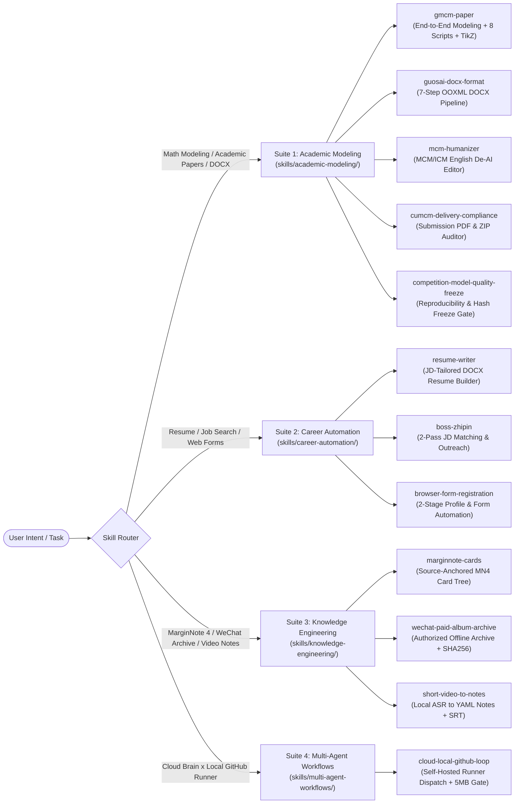

# Claude & Codex Agent Skills Collection

<p align="center">
  <a href="./README.md"><strong>中文文档 (README.md)</strong></a> ·
  <a href="#quick-installation"><strong>Quick Install</strong></a> ·
  <a href="#skill-router-table"><strong>Skill Router Table</strong></a> ·
  <a href="#engineering-deep-dives"><strong>Engineering Deep-Dives</strong></a> ·
  <a href="./docs/MATH_MODELING_LESSONS.md"><strong>Math Modeling Post-Mortem</strong></a>
</p>

<p align="center">
  
  
  
  
  
  
</p>

> **12 battle-tested, script-backed Agent Skills across 4 suites for Claude Code, OpenAI Codex, Cursor, Gemini CLI, and Antigravity.**
>
> Instead of shallow 10-line prompt wrappers, every skill in this collection ships with both `SKILL.md` and `agents/openai.yaml`, backed by **25 executable Python tools**, OOXML/TikZ templates, and hard-won domain pitfall references (`references/`, `scripts/`, `assets/`).

---

## Architecture & Skill Router Diagram



---

## Skill Router Table

| What You Want to Do | Skill Name | Suite | Bundled Scripts & Assets | Compatible Agents |
|---|---|---|---|---|
| **Run an end-to-end graduate mathematical modeling workflow (GMCM)** with page budgets, PDF metadata scrubbing, de-AI linting, and TikZ diagrams | [`gmcm-paper`](skills/academic-modeling/gmcm-paper/SKILL.md) | `academic-modeling` | `page_budget.py`, `paper_lint.py`, `submission_check.py`, `clean_meta.py`, `docx_tools.py`, `figstyle.py` + 6 TikZ templates + 9 reference guides | Claude Code / Codex / Cursor / Antigravity |
| **Transform a Pandoc-generated Chinese research `.docx` into national statistical modeling contest format** in one command | [`guosai-docx-format`](skills/academic-modeling/guosai-docx-format/SKILL.md) | `academic-modeling` | `apply_guosai_format.py` + `step0` through `step7` (9 Python scripts) + 3 OOXML style assets | Claude Code / Codex / Cursor / Antigravity |
| **Eliminate robotic AI phrasing in English MCM/ICM modeling papers** while preserving LaTeX equations and quantitative precision | [`mcm-humanizer`](skills/academic-modeling/mcm-humanizer/SKILL.md) | `academic-modeling` | Section-by-section rewrite rules, AI cliché replacement table, equation explanation guide | Claude Code / Codex / Cursor / Antigravity |
| **Audit a CUMCM contest submission package** (PDF structure, AI-use declaration, code appendix, UTF-8 ZIP flags) | [`cumcm-delivery-compliance`](skills/academic-modeling/cumcm-delivery-compliance/SKILL.md) | `academic-modeling` | Compliance checklist, `pdfinfo`/`pdftotext`/`ZipInfo` verification pipeline | Claude Code / Codex / Cursor / Antigravity |
| **Freeze competition modeling results** with double-run SHA-256 verification and anti-leakage checks before writing the paper | [`competition-model-quality-freeze`](skills/academic-modeling/competition-model-quality-freeze/SKILL.md) | `academic-modeling` | Stage gate checklist, reproducibility hash verification, boundary-case protocol | Claude Code / Codex / Cursor / Antigravity |
| **Extract achievements from raw folders/old resumes and generate JD-tailored `.docx` resumes** with multi-version management | [`resume-writer`](skills/career-automation/resume-writer/SKILL.md) | `career-automation` | `references/checklist.md` + strict fact-only quantification workflow | Claude Code / Codex / Cursor / Antigravity |
| **Automate Boss Zhipin job search**: 2-pass JD requirement matching, tailored outreach greetings, reply drafting, and CSV ledger tracking | [`boss-zhipin`](skills/career-automation/boss-zhipin/SKILL.md) | `career-automation` | 2-pass screening workflow, human-cadence anti-ban pacing, `applied-log.csv` ledger | Claude Code / Codex / Cursor / Antigravity |
| **Parse application documents into a local YAML profile and fill multi-page web registration forms** with pre-submit human confirmation | [`browser-form-registration`](skills/career-automation/browser-form-registration/SKILL.md) | `career-automation` | `assets/profile-template.yaml`, `references/common-fields.md` | Claude Code / Codex / Cursor / Antigravity |
| **Turn MarginNote 4 BreakdownBundles into a source-anchored active-recall mindmap card tree (`result.md`)** without triggering MathJax bugs | [`marginnote-cards`](skills/knowledge-engineering/marginnote-cards/SKILL.md) | `knowledge-engineering` | `build_index.py`, `validate.py`, `card-format.md`, `ocr-fallback.md` | Claude Code / Codex / Cursor / Antigravity |
| **Archive an already-unlocked WeChat Official Account paid album** into offline HTML + local images with SHA-256 verification | [`wechat-paid-album-archive`](skills/knowledge-engineering/wechat-paid-album-archive/SKILL.md) | `knowledge-engineering` | `discover_album.py`, `export_album.py`, `validate_archive.py`, `workflow.md` | Claude Code / Codex / Cursor / Antigravity |
| **Convert short videos (Douyin, WeChat Channels, screen recordings) into YAML-frontmatter Markdown study notes and `.srt` subtitles** | [`short-video-to-notes`](skills/knowledge-engineering/short-video-to-notes/SKILL.md) | `knowledge-engineering` | `extract_and_format.py`, `note-schema.md` (with ASR homophone correction table) | Claude Code / Codex / Cursor / Antigravity |
| **Coordinate a Cloud AI Agent with a local self-hosted GitHub Runner** under strict 5MB and zero-secret guardrails, queuing `.ai/next_task.md` when offline | [`cloud-local-github-loop`](skills/multi-agent-workflows/cloud-local-github-loop/SKILL.md) | `multi-agent-workflows` | `check_guardrails.py`, `queue_next_task.py`, `guardrails-and-templates.md` | Claude Code / Codex / Cursor / Antigravity |

---

## Engineering Deep-Dives

1. **MarginNote 4's Undocumented `$$` LaTeX Corruption Bug (`marginnote-cards`)**:
   MarginNote 4's embedded MathJax breaks whenever `$$...$$` is indented inside a list item (`- `), turning the rest of the card into raw red unrendered text. Bare pipe characters `|x|` inside formulas also shatter Markdown tables. `marginnote-cards` enforces inline `$...$` with `\lvert x \rvert` and verifies every generated `result.md` with `scripts/validate.py`.
2. **7-Step Deterministic OOXML Pipeline (`guosai-docx-format`)**:
   Raw XML edits on `.docx` files fail schema validation if `<w:pageBreakBefore/>` or `<w:footerReference>` are inserted in the wrong child order under `<w:pPr>` / `<w:sectPr>`. Our 7-step pipeline repairs broken Pandoc `<m:oMath>` subscripts/superscripts, injects `<w:cantSplit/>` on every table row, and builds a native Word TOC field.
3. **Cloud Brain × Local Self-Hosted Runner Loop (`cloud-local-github-loop`)**:
   When datasets are hundreds of GBs on a local Mac/Linux workstation, cloud agents dispatch `remote-cmd.yml` jobs with macOS `sandbox-exec` isolation, verify `check_guardrails.py` (blocking files `>5 MB` and any credential/token patterns), and fall back to `.ai/next_task.md` when the host machine is asleep.

---

## Quick Installation

```bash
git clone https://github.com/ychenfen/claude-agent-skills-collection.git
cd claude-agent-skills-collection

# List all 12 skills across 4 suites
./install.sh --list

# Install all 12 skills to both Claude Code (~/.claude/skills) and OpenAI Codex (~/.codex/skills)
./install.sh --all --target both

# Install a single suite (e.g. academic-modeling) to Claude Code only
./install.sh --suite academic-modeling --target claude

# Install a single skill (e.g. gmcm-paper)
./install.sh --skill gmcm-paper --target both
```

## Validation & CI

```bash
python3 scripts/validate_skills.py
python3 skills/multi-agent-workflows/cloud-local-github-loop/scripts/check_guardrails.py .
```

## License

Released under the [MIT License](./LICENSE).
